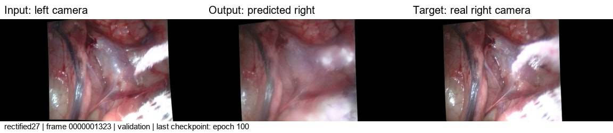
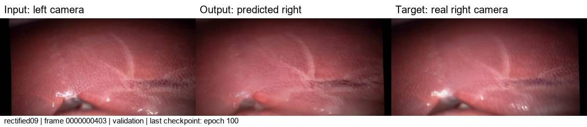
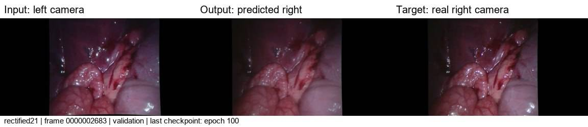

# Surgical Stereo Synthesis

**Generating a synthetic right endoscopic view from a single left-camera image using deep learning.**

## Qualitative Results

The following examples demonstrate the current performance of our U-Net model on unseen validation samples after 100 training epochs.

Each row presents:
- **Input:** Original left-camera image.
- **Prediction:** Right-camera view generated by our model.
- **Ground Truth:** Corresponding real right-camera image.

### Result 1 — rectified27

### Result 2 — rectified09

### Result 3 — rectified21

These qualitative results illustrate the model's ability to generate an estimated right-camera view from a single left-camera image.

---

## Project Overview

Stereoscopic visualization plays an important role in minimally invasive surgery by helping surgeons perceive depth, estimate distances, and understand spatial relationships between tissues and surgical instruments.

Conventional stereoscopic endoscopes use two cameras to capture different viewpoints of the same surgical scene. However, these specialized systems can be expensive and may not be readily available in every surgical setting.

This project explores an AI-based alternative: **generating the missing right-camera view from a single left-camera image using deep learning.**

Our goal is to develop a model that can generate an estimated stereo image pair using a conventional single-camera endoscope.

## Project Objective

The main objective is to develop a deep learning model that:

- Takes a single left-camera endoscopic image as input.
- Predicts the corresponding right-camera view.
- Combines the original left view with the generated right view to produce an estimated stereo pair.

During training, paired left and right images are used to learn the relationship between the two viewpoints. During inference, only the left-camera image is required.

## Methodology

### 1. Dataset Preparation

The project uses paired rectified endoscopic images from the Hamlyn surgical stereo dataset.

The dataset pipeline:
- Discovers multiple rectified image sequences.
- Matches corresponding left and right frames using sequence and frame identifiers.
- Detects missing and duplicate frames.
- Loads RGB images and prepares them for model training.
- Preserves sequence and frame metadata.

### 2. Image Preprocessing

- RGB image loading.
- Conversion to normalized tensors in the range [0, 1].
- Resizing images to 384 × 192 pixels.
- Preserving frame and sequence information.

### 3. Training and Validation Split

The dataset is divided using sequence-level splitting:

- 80% Training
- 20% Validation

This approach prevents frames from the same sequence from appearing in both subsets.

### 4. U-Net Architecture

A U-Net-based encoder-decoder architecture is used to learn the mapping between the two camera views.

The network includes:
- Five-level encoder.
- Bottleneck layer.
- Five-level decoder.
- Skip connections.
- RGB input and output layers.

**Input:** Left-camera image

**Output:** Predicted right-camera image

### 5. Model Training

The model is trained using a perceptual loss based on a pretrained VGG16 feature extractor.

Current training configuration:

| Parameter | Configuration |
|---|---|
| Model | U-Net |
| Loss | VGG16 Perceptual Loss (MAE) |
| Optimizer | Adam |
| Learning Rate | 0.0001 |
| Epochs | 100 |
| Validation | Every epoch |

The best-performing and latest model checkpoints are saved during training.

## Project Pipeline

**Training:**

Paired Stereo Dataset → Frame Matching → Preprocessing → Dataset Splitting → U-Net → Perceptual Loss Optimization → Validation & Checkpoint Saving

**Inference:**

Single Left-Camera Image → Trained U-Net → Predicted Right-Camera Image → Estimated Stereo Pair

## Current Progress

- [x] Multi-sequence dataset pipeline
- [x] Stereo frame matching and validation
- [x] Image preprocessing and DataLoader
- [x] U-Net architecture implementation
- [x] Training and validation pipeline
- [x] Model checkpoint saving
- [x] Initial 100-epoch training experiment
- [x] Qualitative visualization of validation predictions
- [ ] Further model optimization
- [ ] Improved stereo-view consistency
- [ ] Exploration of advanced generative architectures

## Future Directions

Future work will focus on improving the visual quality and structural consistency of the generated right view, exploring more advanced generative models, and evaluating the usefulness of estimated stereo pairs for depth perception.

## Important Note

The generated right view is an AI-based prediction, not an actual second-camera capture. This project is a research prototype and does not claim clinical validation.
